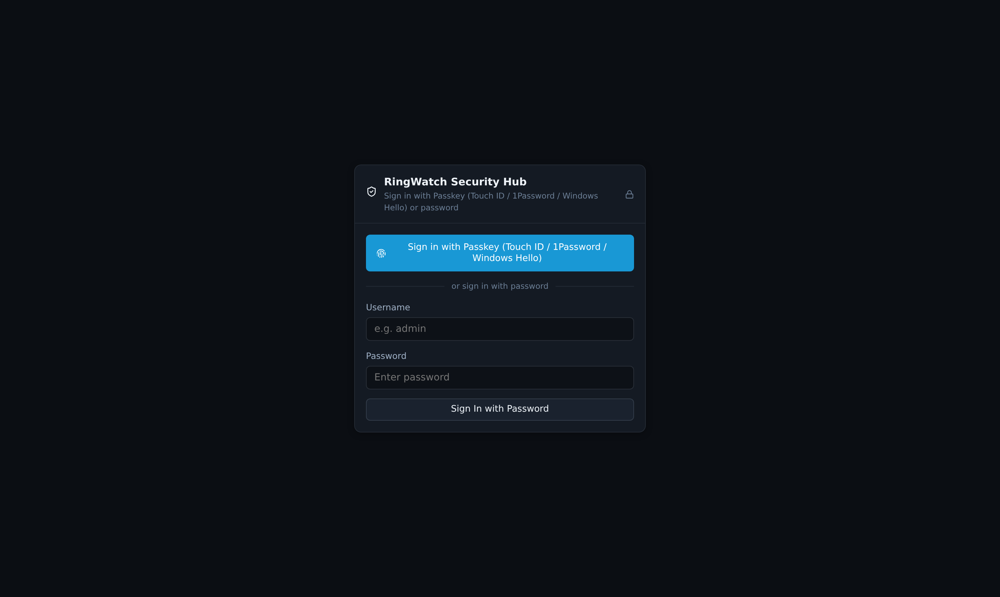
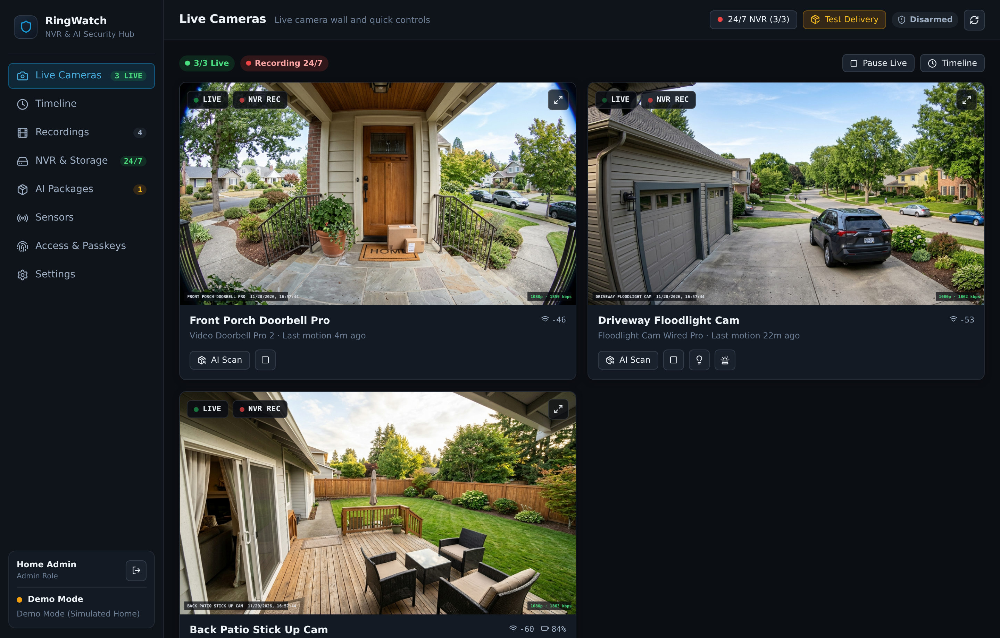
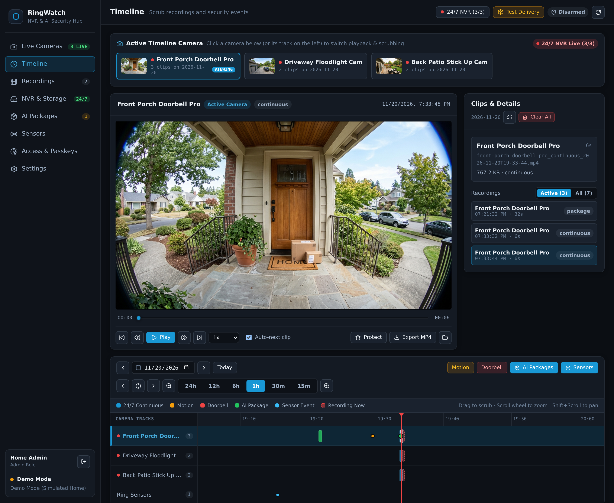
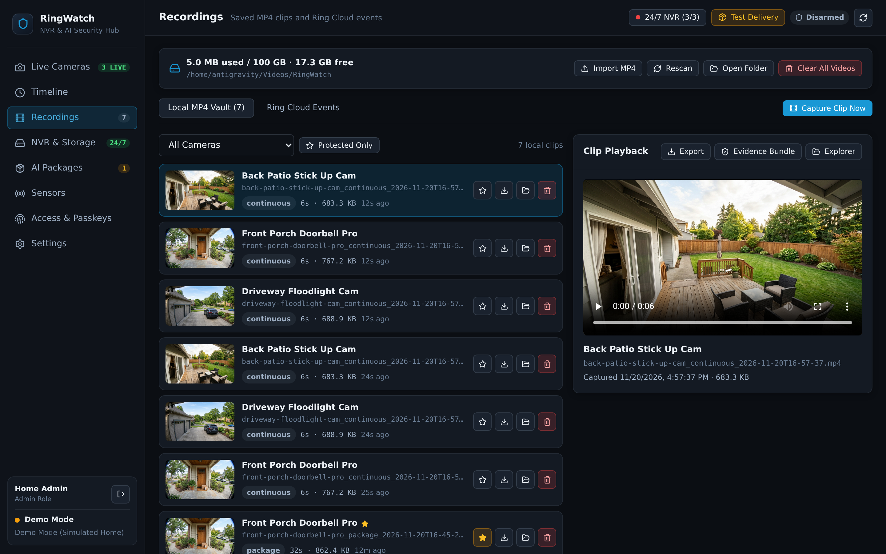
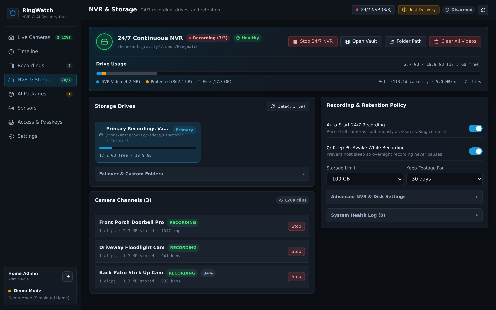
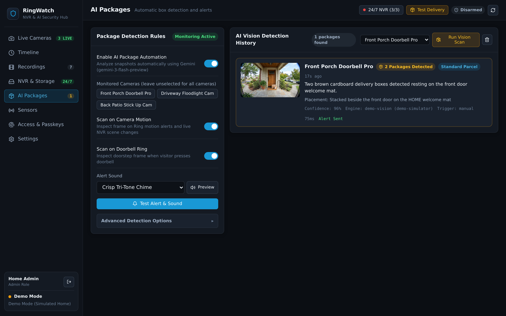
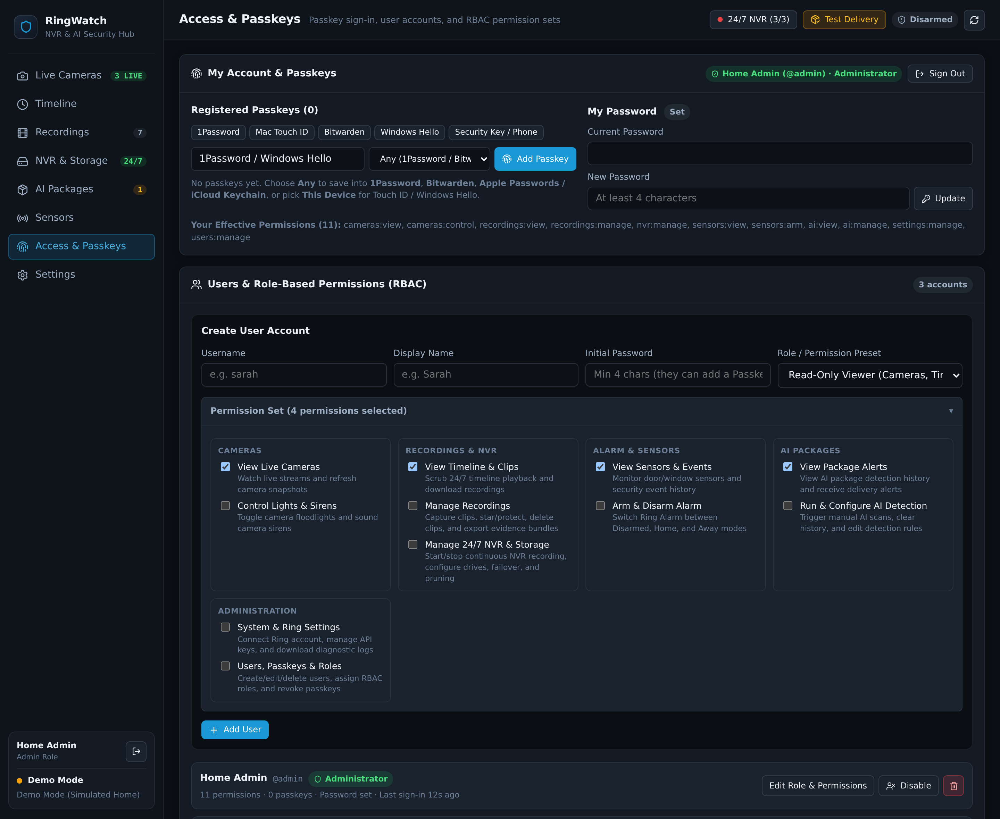
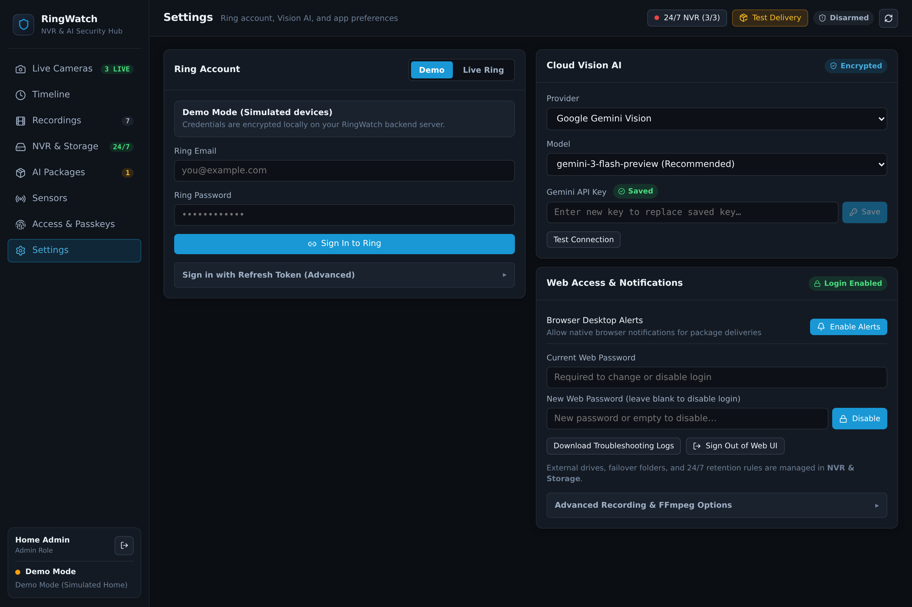

# RingWatch — 24/7 Local Ring NVR, AI Package Detection & Multi-User Web Hub

**RingWatch** is a self-hosted **24/7 Network Video Recorder (NVR)**, **AI Package Detection Engine**, and **cross-platform Web Security Hub** for Ring cameras, doorbells, and Ring Alarm sensors.

It pairs a lightweight **Standalone Node.js Backend** (with a native Windows Service + Taskbar Tray Icon) with a responsive **Web Frontend** that runs seamlessly in **Windows and macOS** browsers (Chrome, Edge, Safari) or as an installable **PWA** across your local network.

---

## Screenshots

### Passkey & Multi-User Sign-In Gate
Passwordless sign-in with **FIDO2 Passkeys** (Windows Hello, macOS Touch ID, Face ID, or security keys) alongside multi-user username/password authentication.



### Live Cameras Wall
Real-time low-latency HLS multi-camera view, 24/7 NVR recording status badges, instant snapshots, floodlight/siren controls, one-click AI scans, and role-aware sidebar.



### Interactive Multi-Camera Timeline
Smooth 60fps multi-track timeline scrubbing (`24h` down to `15m` zoom) with Windows mouse-wheel & macOS trackpad pinch/swipe support, motion/doorbell/AI/sensor markers, and one-click **Clear All**.



### Local MP4 Recordings Vault
Browse, filter, star/protect, stream (`HTTP 206 Range`), import `.mp4` files from any browser, export clips with tamper-evident **SHA-256 Evidence Bundles**, sync Ring Cloud clips, or clear the vault in one click.



### 24/7 NVR & Storage Console
Manage continuous per-camera recording, automatic internal/USB/NAS drive detection, primary + failover storage vaults, rolling storage quotas, retention policies, **Open Vault**, **Folder Path**, and **Clear All Videos**.



### AI Package Detection & Alerts
Automatic box and parcel detection powered by **Google Gemini Vision** or **OpenAI Vision (GPT-4o / 4.1)** with before/after baseline comparison, zoomed ground/porch delivery-zone crop, local NVR scene-change triggering, and customizable chime + browser desktop alerts.



### Multi-User Passkeys (WebAuthn) & RBAC Permissions
Enroll Windows Hello / Touch ID passkeys and assign **4 built-in role presets** or customize all **11 granular RBAC permissions** across Cameras, Recordings & NVR, Alarm & Sensors, AI Packages, and Administration.



### Settings, Encrypted Credentials & Troubleshooting Logs
Configure Ring account sign-in, encrypted Cloud Vision AI keys, browser desktop alerts, web access controls, and one-click **Troubleshooting Log** downloads.



---

## Key Features

- **24/7 Continuous Local NVR**: Records fragmented MP4 segments continuously to your local disk, external USB drive, or NAS with automatic failover, rolling quota/retention pruning, star-protected clips, and watchdog auto-recovery.
- **Native Windows Service & Taskbar Tray Icon**: Runs headless 24/7 as `RingWatchNvrService` (`RingWatchService.exe`) with automatic boot startup and crash recovery, paired with a native system tray icon (`RingWatchTray.exe`) offering Green/Amber/Red status, Start/Stop/Restart without UAC prompts, Live Log Viewer, Verbose Debug toggle, and one-click Troubleshooting Log export.
- **Cross-Platform Web UI (Windows & macOS)**: Native Apple SF typography & Safari HLS playback on macOS, Fluent/Segoe styling on Windows, smooth trackpad pinch-to-zoom & horizontal swipe on the Timeline, and installable PWA support.
- **Cost-Optimized AI Package Detection**: Supports OpenAI Vision (`gpt-4.1-nano` / `gpt-4o-mini` / `gpt-4.1-mini` / `gpt-4o`) and Google Gemini Vision (with `thinkingBudget: 0` & automatic 503 failover) behind a **6-layer cost-saver pipeline**: `$0` local persistent-baseline frame gating, single settled scans, two-stage low-res triage → selective high-res confirm (`Economy` / `Balanced` / `High Accuracy`), per-camera motion throttle, already-present pause, daily auto-scan cap, active delivery hours, Ring non-person CV filtering, and live **AI Usage & Savings Today** telemetry.
- **Multi-User Auth, Passkeys & RBAC**:
  - **Passkeys (WebAuthn / FIDO2)** + scrypt password sign-in with signed HTTP-only session cookies.
  - **4 Role Presets** (**Administrator**, **Home Operator**, **Read-Only Viewer**, **Guest Live Only**) plus **Custom Permission Sets** across 11 granular permissions enforced on every REST endpoint, media stream, and SSE event channel.
- **Local Vault & Evidence Bundles**: Stream recordings over HTTP 206 Range, upload/import `.mp4` files from any browser, export clips with SHA-256 `.evidence.json` manifests, auto-purge demo clips in Live Mode, and wipe all recordings cleanly via **Clear All Videos**.
- **Security-First Design**: AES-256-GCM encrypted local secret storage for Ring tokens & AI API keys, per-session media tokens, DNS-rebinding host validation, automatic secret redaction in troubleshooting logs, and zero runtime npm vulnerabilities.

---

## Architecture

1. **Standalone Node.js Backend (`server/`)** — Manages Ring WebRTC/HLS sessions, 24/7 FFmpeg MP4 recording, disk retention & failover, AI Vision scans, multi-user WebAuthn/RBAC auth, REST API (`/api/*`), authenticated media routes (`/media/<token>/...`), and Server-Sent Events (`/api/events`).
2. **React + TypeScript Web Frontend (`src/`)** — Connects over HTTP + SSE from any browser on Windows, macOS, tablet, or mobile.
3. **Native Windows Service & Tray Companion (`windows/`)** — Lightweight .NET service wrapper (`RingWatchService.exe`) and taskbar tray controller (`RingWatchTray.exe`) compiled cleanly in CI.

---

## Quick Start

### Option 1 — Windows Self-Contained Release Package (Recommended, No Node.js Required)

1. Download **`RingWatch-Windows-Server-v2.1.0.zip`** from the [**Latest GitHub Release**](https://github.com/mattalter2024/Ring/releases/latest).
2. Unzip it to a permanent folder (for example, `C:\RingWatch\`).
3. **Install as a 24/7 Windows Service + Taskbar Tray Icon**:
   - Double-click **`install-windows-service.bat`** and approve the Administrator prompt.
   - Installs and starts **`RingWatchNvrService`** (starts automatically at boot with crash recovery).
   - Launches **`RingWatchTray.exe`** in your taskbar showing **Green (Running)** / **Amber (Starting)** / **Red (Stopped)** status with right-click controls for **Open Web UI**, **Start / Stop / Restart**, **View Live Logs**, **Export Troubleshooting Log**, and **Verbose Debug Logging**.
   - To uninstall later, double-click **`uninstall-windows-service.bat`**.
4. **Or run in foreground without installing a service**:
   - Double-click **`start-ringwatch.bat`** to start the backend and open **`http://localhost:3456`** automatically.

*(The Windows ZIP already bundles `runtime\node.exe`, `ffmpeg.exe`, `RingWatchService.exe`, `RingWatchTray.exe`, the prebuilt Web UI, and all runtime dependencies.)*

### Option 2 — macOS / Linux / Cross-Platform Release Package (Node.js 20+ / 24 LTS)

1. Download **`RingWatch-CrossPlatform-v2.1.0.tar.gz`** from the [**Latest GitHub Release**](https://github.com/mattalter2024/Ring/releases/latest) (or clone this repo).
2. Extract and start:

```bash
tar -xzf RingWatch-CrossPlatform-v2.1.0.tar.gz
cd RingWatch-CrossPlatform
npm ci --omit=dev
npm start
```

Open **`http://localhost:3456`** in Safari, Chrome, or Edge (or access via your server's LAN IP from any Mac or Windows PC).

### Option 3 — Build & Run from Source

```bash
# 1. Install dependencies
npm install

# 2. Build both Web Frontend (dist/) and Backend (dist-server/)
npm run build

# 3. Start the NVR & AI backend (also serves the Web UI on port 3456)
npm start
```

---

## Development Mode (Hot-Reload Frontend + Live Backend)

```bash
npm run dev
```

- **Backend API / NVR / AI**: `http://127.0.0.1:3456`
- **Vite Web Frontend**: `http://127.0.0.1:5173` (automatically proxies `/api` and `/media` to the backend)

---

## Privacy, Ring Login Credentials & Secret Storage

RingWatch is **100% self-hosted on your own machine** with **zero external telemetry, zero cloud relay servers, and zero third-party analytics**.

### How Your Ring Login Credentials Are Used
- **Never Saved to Disk**: When you sign in via **Settings -> Ring Account**, your Ring **email**, **password**, and **2FA verification code** are sent directly over HTTPS from your local RingWatch backend to Ring's official OAuth endpoint (`ring-client-api`) **solely to exchange them for an OAuth refresh token**.
- **Immediately Discarded**: Your Ring email, password, and 2FA code are **never written to disk, never saved in config files, never written to logs, and never sent to any third-party server**. The temporary in-memory login client is cleared immediately after authentication succeeds.
- **Password-Free Token Option**: If you prefer not to enter your Ring password into RingWatch at all, open **Settings -> Ring Account -> Sign in with Refresh Token (Advanced)** and paste an OAuth refresh token generated locally via `npx -p ring-client-api ring-auth-cli`.

### What Is Stored Locally (and How It Is Protected)
| Credential / Secret | Stored on Disk? | Location & Encryption |
| --- | --- | --- |
| **Ring Email, Password & 2FA Code** | **No — Never stored** | Used transiently in memory only during OAuth sign-in, then discarded. |
| **Ring OAuth Refresh Token** | **Yes — Encrypted locally** | Stored inside `ringwatch-config.json` in `RINGWATCH_DATA_DIR`, encrypted at rest using **AES-256-GCM** with a unique random 256-bit local key (`.ringwatch-secret.key`, file permissions `0600`) and a random 96-bit IV + 128-bit auth tag per secret. Auto-updates silently when Ring rotates tokens. |
| **OpenAI / Gemini Vision API Keys** *(optional)* | **Yes — Encrypted locally** | Same **AES-256-GCM** encryption inside `ringwatch-config.json`. Only used if you enable AI Package Detection and supply your own key. |
| **Web UI Passwords** *(optional)* | **Hashed only** | Stored in `ringwatch-users.json` as salted **scrypt** hashes (`scrypt$<16-byte-salt>$<32-byte-hash>`), verified with timing-safe comparison. |
| **WebAuthn Passkeys** *(Touch ID, 1Password, Bitwarden, Windows Hello)* | **Public key only** | `ringwatch-users.json` stores only the FIDO2 credential ID and public key. Your biometrics and private key never leave Touch ID, Windows Hello, 1Password, Bitwarden, iCloud Keychain, or your hardware security key. |

### Additional Credential Safeguards
- **Never Exposed to the Browser**: API responses (`GET /api/bootstrap`, `PATCH /api/settings`) only return boolean indicators (`hasRingToken`, `hasOpenaiKey`, `hasGeminiKey`) — raw tokens and API keys never leave the local backend.
- **Automatic Log Redaction**: Rotating backend logs (`ringwatch-backend.log`) and **Troubleshooting Log** downloads automatically scrub `Bearer` tokens, `refresh_token` payloads, OpenAI keys (`sk-...`), Gemini keys (`AIza...`), and `x-goog-api-key` headers before writing.
- **One-Click Revocation**: Clicking **Disconnect** in **Settings -> Ring Account** immediately deletes the encrypted Ring refresh token from `ringwatch-config.json`. You can also revoke the `RingWatch Windows` session anytime from the official **Ring App -> Control Center -> Authorized Client Devices**.

---

## Passkeys (Touch ID, 1Password, Bitwarden, iCloud Keychain & Windows Hello)

RingWatch uses standard **FIDO2 / WebAuthn discoverable Passkeys** (`residentKey: required`, ES256/RS256) with **WebAuthn Conditional UI** (`autocomplete="username webauthn"`):

- **Password Managers (1Password, Bitwarden, Dashlane, Proton Pass, Apple Passwords)**: Leave the Passkey storage selector on **Any (1Password / Bitwarden / OS)** when adding a Passkey in **Access & Passkeys**. Your browser extension or OS password manager will prompt to save a **Synced Passkey**, and clicking the **Username** field on the Sign-In screen will automatically show Passkey & password autofill.
- **macOS Touch ID & Windows Hello**: Pick **Mac Touch ID** or **Windows Hello** (or choose **This Device**) to bind a biometric passkey directly to your Mac or PC.
- **Important URL Requirement (WebAuthn Browser Rule)**: Browsers only allow Passkeys on `http://localhost:3456` or an `https://` hostname (never on raw IP addresses like `127.0.0.1` or `http://192.168.x.x`). For LAN Passkey access across Macs, Windows PCs, and phones, put RingWatch behind HTTPS (e.g. Tailscale HTTPS, Caddy, or Nginx) and optionally set `RINGWATCH_WEBAUTHN_RP_ID` / `RINGWATCH_WEBAUTHN_ORIGIN`.

---

## Configuration (Environment Variables — All Optional)

| Variable | Default | Description |
| --- | --- | --- |
| `PORT` | `3456` | HTTP port for Web UI, REST API, SSE, and media streams |
| `HOST` | `0.0.0.0` | Bind address (`127.0.0.1` for local-only, `0.0.0.0` for LAN access) |
| `RINGWATCH_DATA_DIR` | `%APPDATA%\RingWatch` (Win) / `C:\ProgramData\RingWatch\data` (Win Service) / `~/.ringwatch` | Config, encrypted secrets, user database, logs, and recordings index folder |
| `RINGWATCH_RECORDINGS_DIR` | `~/Videos/RingWatch` | Default primary NVR recordings directory |
| `RINGWATCH_DEBUG` | `0` | Set to `1` for verbose debug logging |
| `RINGWATCH_AUTH_PASSWORD` | *(unset — managed via Access & Passkeys UI)* | Optional environment-enforced fallback admin login password |
| `RINGWATCH_WEBAUTHN_RP_ID` | *(derived from request Host/Origin)* | Optional Relying Party domain override when serving behind an HTTPS reverse proxy |
| `RINGWATCH_WEBAUTHN_ORIGIN` | *(derived from request Origin)* | Optional full `https://...` origin override for WebAuthn behind a reverse proxy |

---

## Verification Scripts

```bash
npm audit --omit=dev --audit-level=high   # Zero high/critical runtime vulnerabilities
npm run typecheck                         # TypeScript checks for Web Frontend & Node.js Backend
npm test                                  # 39 unit & HTTP/SSE/RBAC/Vault integration tests
npm run build                             # Production build (dist/ + dist-server/)
```
