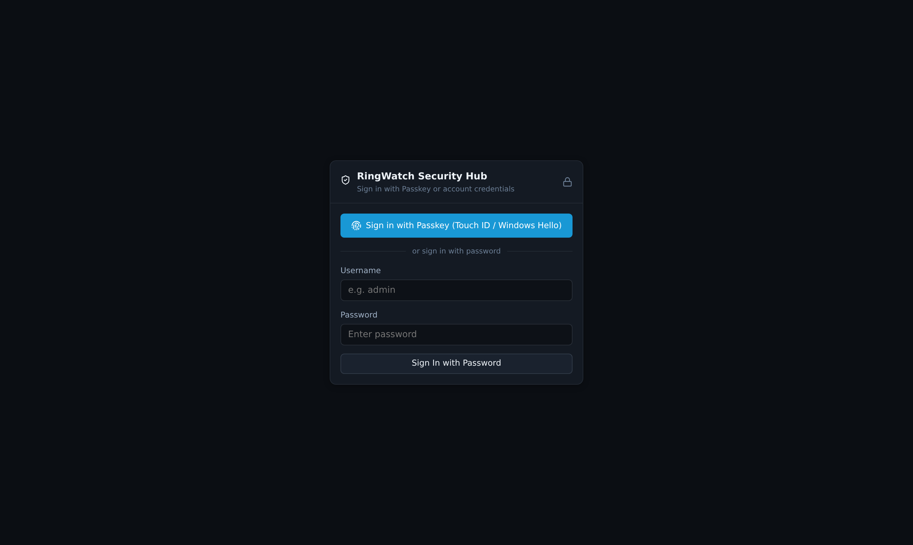
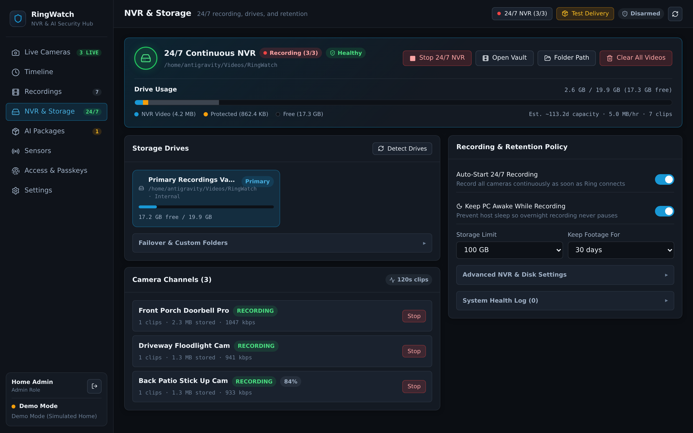
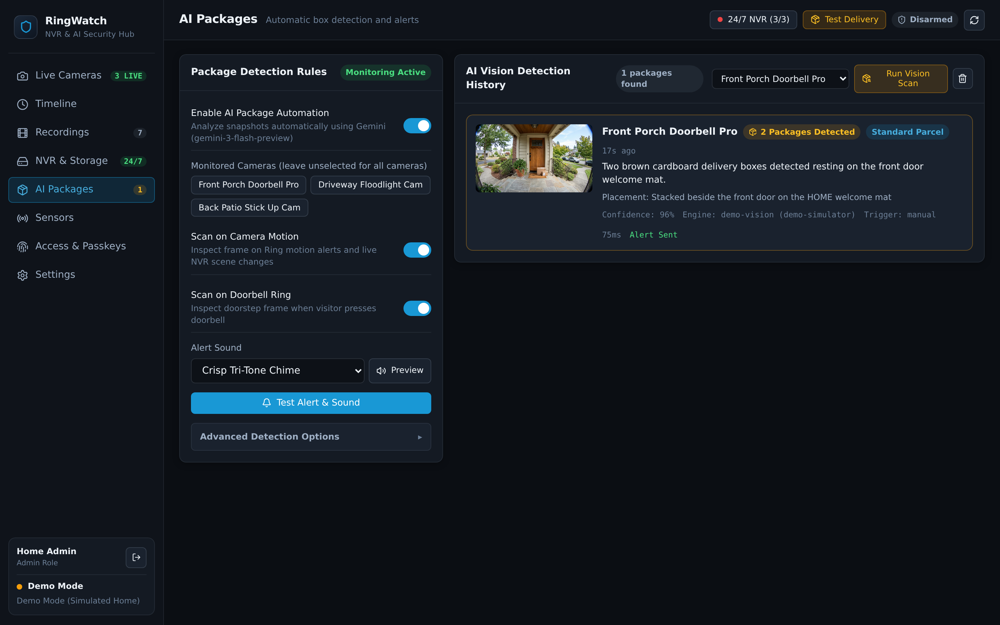

# RingWatch v2.0.0 — Standalone 24/7 NVR, AI Package Detection, Passkeys & RBAC

**RingWatch v2.0.0** separates the app into a high-performance **Standalone 24/7 NVR & AI Backend** (with native Windows Service & Taskbar Tray Icon) and a modern **Cross-Platform Web Hub** for **Windows and macOS** browsers + PWA.

---

## Highlights

- **Standalone 24/7 Backend + Web Frontend**: Run the NVR & AI engine 24/7 headless on your host while viewing live feeds, scrubbing the timeline, and managing clips from any Windows or macOS browser on your network.
- **Native Windows Service & Taskbar Tray Icon**: One-click `install-windows-service.bat` sets up `RingWatchNvrService` (`Automatic` boot start + crash recovery) and launches `RingWatchTray.exe` with live Green/Amber/Red status, Start/Stop/Restart controls, Live Log Viewer, Verbose Debug toggle, and Troubleshooting Log export.
- **Windows & macOS Frontend Support**: Adaptive Apple SF typography & Safari native HLS playback on macOS, Fluent styling on Windows, smooth trackpad pinch-to-zoom & horizontal swipe on the Timeline, OS-aware Finder/Explorer labels, and installable PWA manifest.
- **Multi-User Auth, Passkeys (WebAuthn/FIDO2) & RBAC**: Passwordless sign-in via Windows Hello, Touch ID, Face ID, or security keys, plus 4 built-in role presets (**Administrator**, **Home Operator**, **Read-Only Viewer**, **Guest Live Only**) and 11 granular customizable permissions enforced across REST, media streams, and SSE.
- **Reliable AI Package Detection**: Supports OpenAI Vision and Google Gemini Vision with before/after baseline comparison, zoomed ground delivery-zone crop, illumination-normalized local NVR visual scene-change triggers (works reliably during 24/7 recording), and automatic Gemini 503 failover.
- **Upgraded Recordings Vault & Timeline**: Direct **Open Vault** navigation, clipboard-backed **Folder Path** / **Open Folder**, browser **Import MP4** upload, fixed **SHA-256 Evidence Bundle** export, automatic demo-video purge in Live Mode, and a confirmed **Clear All Videos** action.

---

## App Screenshots

### Passkey & Multi-User Sign-In Gate

### Live Cameras Wall

### Interactive Multi-Camera Timeline

### Local MP4 Recordings Vault

### 24/7 NVR & Storage Console

### AI Package Detection & Alerts

### Multi-User Passkeys & RBAC Permissions

### Settings, Vision AI & Troubleshooting Logs

---

## Release Packages

| Asset | Platform | Notes |
| --- | --- | --- |
| **`RingWatch-Windows-Server-v2.0.0.zip`** | Windows 10 / 11 (x64) | **100% self-contained** — bundles `node.exe`, `ffmpeg.exe`, `RingWatchService.exe`, `RingWatchTray.exe`, prebuilt Web UI, and runtime dependencies. Unzip and run `install-windows-service.bat` (24/7 Service + Tray Icon) or `start-ringwatch.bat`. |
| **`RingWatch-CrossPlatform-v2.0.0.tar.gz`** | macOS / Linux (Node.js 20+) | Prebuilt Web UI + Backend bundle. Extract, run `npm ci --omit=dev && npm start`, and open `http://localhost:3456`. |
| **`SHA256SUMS.txt`** | All | SHA-256 verification checksums for both release archives. |
