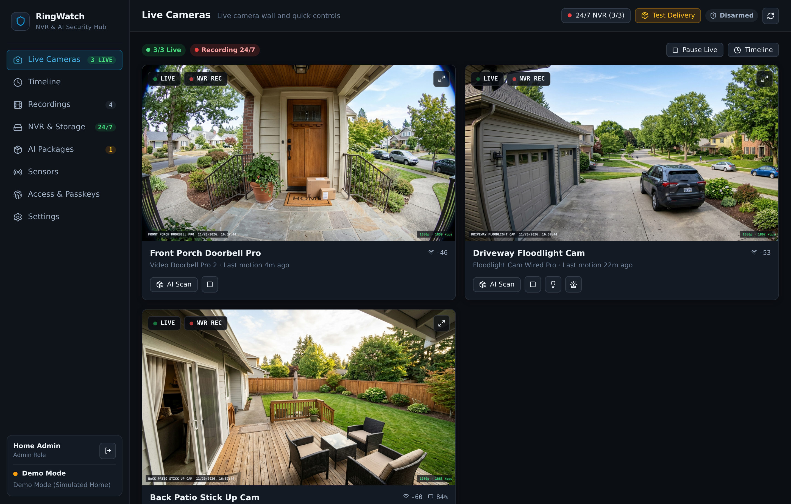
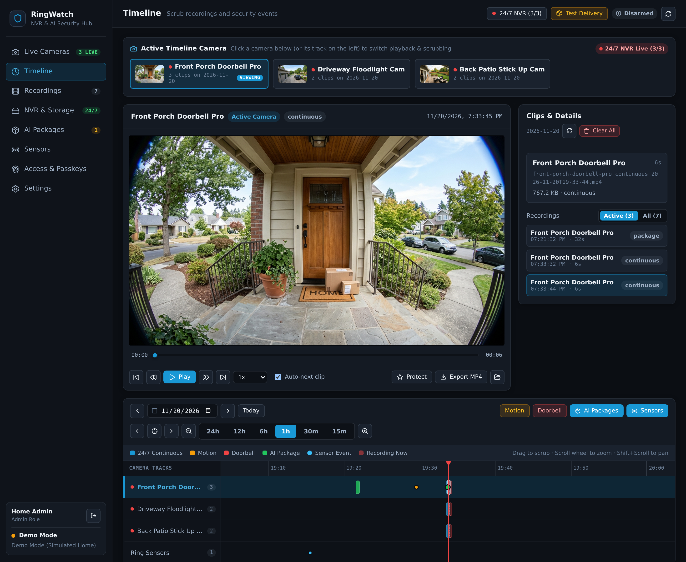
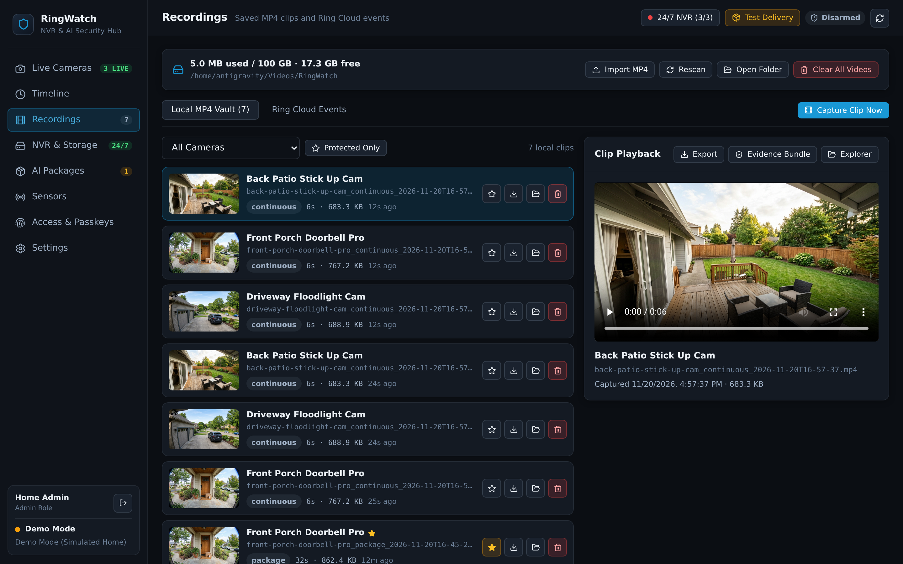
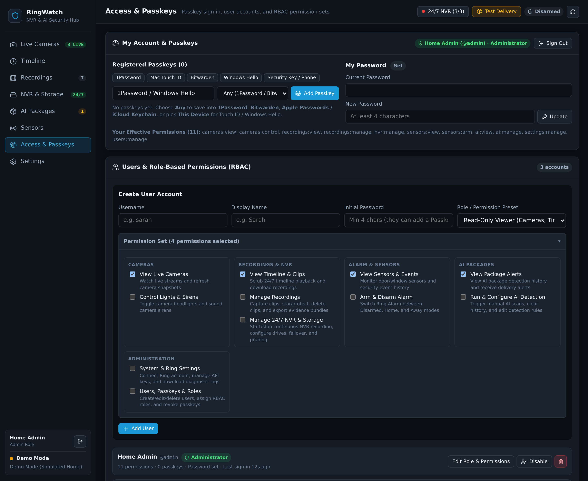
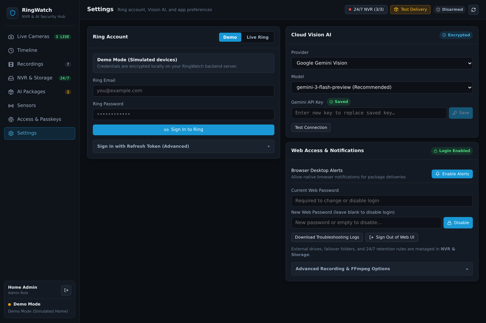

# RingWatch v2.1.0 — AI Vision Cost-Saver Pipeline, Universal Passkeys & 24/7 NVR

**RingWatch v2.1.0** adds a **6-Layer AI Vision Cost-Saver Pipeline** (cutting OpenAI / Gemini API spend dramatically on non-delivery motion while preserving high package accuracy), upgrades **FIDO2 Passkeys** for **macOS Touch ID, 1Password, Bitwarden, iCloud Keychain & Windows Hello**, and includes full **Ring Credential Privacy & Encryption** guarantees.

---

## What's New in v2.1.0

- **6-Layer AI Vision Cost-Saver Pipeline**:
  1. **Local Persistent-Baseline Gate (`$0` CPU)**: Skips Cloud Vision completely when post-motion snapshots settle back to the confirmed clean porch baseline (passing cars, wind, shadows, people walking past without dropping a box).
  2. **Single Settled Scan**: Eliminates blind 3–5× API bursts on empty motion; only schedules a single `+15s` follow-up when a person/courier is visible, the doorbell is pressed, or a transient API/snapshot error occurs.
  3. **Two-Stage Vision Cost & Quality Modes (`Economy` / `Balanced` / `High Accuracy`)**: Default **`Balanced`** mode sends 1 low-res triage frame (`detail: low` / `MEDIA_RESOLUTION_LOW`) and only escalates to high-res (`BEFORE` + `AFTER` + zoomed delivery crop) when uncertain or borderline (`confidence < 0.85`).
  4. **Scan Throttle, Already-Present Pause, Daily Cap & Active Delivery Hours**: Enforces a per-camera minimum motion scan gap (default `90s`), pauses motion re-scans while a package is already present, caps daily auto scans (default `60/day`; manual scans always allowed), supports optional delivery-hours windows, and displays live **AI Usage & Savings Today** telemetry (`GET /api/ai/usage`).
  5. **Compact Prompts, Disabled Gemini Thinking Tokens & `gpt-4.1-nano`**: Uses compact JSON triage prompts, lowers output cap to `220` tokens, sets Gemini `thinkingConfig: { thinkingBudget: 0 }` (with automatic HTTP 400 fallback), and adds `gpt-4.1-nano (Ultra low cost)` in Settings.
  6. **Ring Free CV Event Filtering**: Drops Ring motion events explicitly tagged as vehicles, animals, or `other_motion` while keeping doorbell rings, person/package events, and unclassified motion intact.
- **Universal Passkeys (Touch ID, 1Password, Bitwarden, iCloud Keychain & Windows Hello)**: Discoverable FIDO2 Passkeys (`residentKey: required`) with **WebAuthn Conditional UI** autofill directly in the sign-in box, authenticator presets (**Any / 1Password / Bitwarden**, **This Device / Touch ID / Windows Hello**, **Security Key**), `127.0.0.1` → `localhost` WebAuthn guard, and `RINGWATCH_WEBAUTHN_RP_ID` / `ORIGIN` reverse-proxy support.
- **Ring Credential Privacy & Local Encryption**: Your Ring email, password, and 2FA code are **never saved to disk or logged**—used transiently only to obtain a Ring OAuth refresh token directly from Ring. Only the refresh token (and optional AI API keys) are saved locally in `ringwatch-config.json`, encrypted at rest with **AES-256-GCM** (`.ringwatch-secret.key`, mode `0600`), never returned to the browser, and automatically redacted from troubleshooting logs.
- **Standalone 24/7 Backend + Windows Service & Tray + Web Hub**: Native `RingWatchService.exe` & `RingWatchTray.exe`, multi-user RBAC (4 presets + 11 granular permissions), interactive multi-camera Timeline, browser `.mp4` vault import, SHA-256 Evidence Bundles, and **Clear All Videos**.

---

## App Screenshots

### Passkey & Multi-User Sign-In Gate

### Live Cameras Wall

### Interactive Multi-Camera Timeline

### Local MP4 Recordings Vault

### 24/7 NVR & Storage Console

### AI Package Detection & Alerts

### Multi-User Passkeys & RBAC Permissions

### Settings, Vision AI & Troubleshooting Logs

---

## Release Packages

| Asset | Platform | Notes |
| --- | --- | --- |
| **`RingWatch-Windows-Server-v2.1.0.zip`** | Windows 10 / 11 (x64) | **100% self-contained** — bundles `node.exe`, `ffmpeg.exe`, `RingWatchService.exe`, `RingWatchTray.exe`, prebuilt Web UI, and runtime dependencies. Unzip and run `install-windows-service.bat` (24/7 Service + Tray Icon) or `start-ringwatch.bat`. |
| **`RingWatch-CrossPlatform-v2.1.0.tar.gz`** | macOS / Linux (Node.js 20+) | Prebuilt Web UI + Backend bundle. Extract, run `npm ci --omit=dev && npm start`, and open `http://localhost:3456`. |
| **`SHA256SUMS.txt`** | All | SHA-256 verification checksums for both release archives. |
